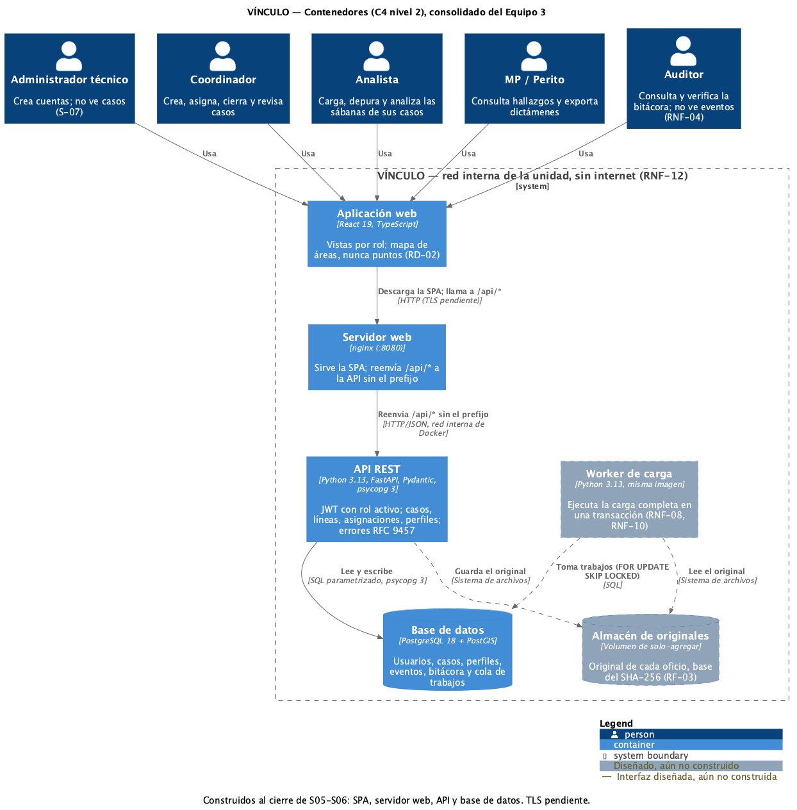
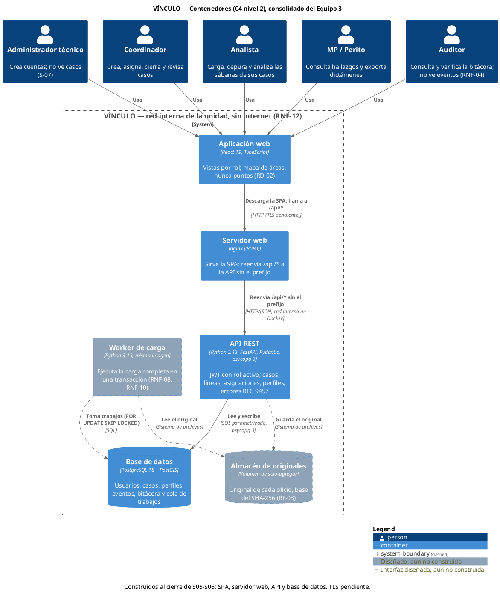
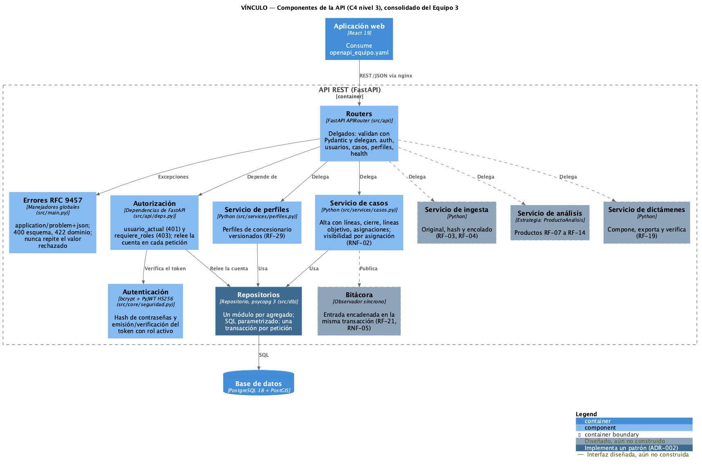
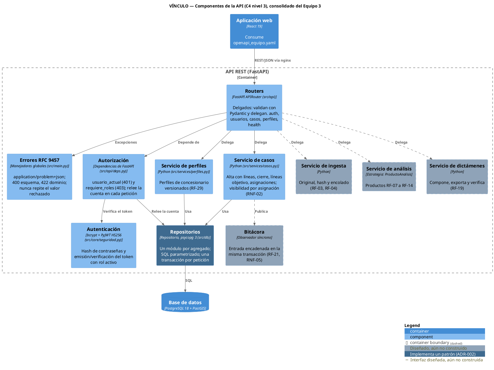

# Arquitectura del Equipo 3 — VÍNCULO (S05-S06-A1)

**Equipo 3:** Francisco Leonardo Armendáriz Cavazos, José Francisco González Vargas, José Benjamín
Oviedo Morales y Mario Sánchez Valtierra.
**Base:** `S04_A1/decision_arquitectonica.md` y `S04_A1/diagrama_componentes.puml` de J. B. Oviedo,
adoptados por acuerdo del equipo el 2026-10-24. Los cambios respecto de esa base (A-1 a A-3) se
justifican en `diferencias_diseno.md`.
**Contrato:** `openapi_equipo.yaml`. **Modelo:** `diagrama_clases_equipo.puml`.

## Decisión (se mantiene ADR-001 de S04-A1)

Cliente-servidor con **backend monolítico modular en capas** y un proceso *worker* para las
cargas, con la cola de trabajos en la misma base PostgreSQL. Los motivos de S04 siguen vigentes:
un solo desarrollador por módulo, 8 sesiones simultáneas (RNF-14), consultas analíticas cerca de
los datos (RNF-07) y cargas de hasta 5 minutos que no deben bloquear la API (RNF-08).

| Elemento | Tecnología | Estado al cierre de S05-S06 |
|---|---|---|
| Aplicación web (SPA) | React 19, TypeScript | Construida (esqueleto); las vistas de análisis son de S07-S08 |
| Servidor web | nginx sin privilegios, `:8080`; quita el prefijo `/api` | Construido |
| API REST | Python 3.13, FastAPI 0.141, Pydantic 2, psycopg 3 | Construida: autenticación, usuarios, casos, líneas, asignaciones y perfiles |
| Base de datos | PostgreSQL 18 + PostGIS | Construida; esquema en `esquema_bd.sql` |
| Worker de carga | Misma imagen que la API | Planeado (S07 en adelante) |
| Almacén de originales | Volumen de solo-agregar | Planeado |

## Cambios respecto de S04-A1

- **A-1 · Capa de servicios.** S04 define routers → servicios → repositorios. La A2 llamaba del
  router al repositorio. Desde esta actividad los routers solo traducen HTTP y delegan en
  servicios (`backend/src/services/`), que aplican las reglas de negocio; los repositorios
  (`backend/src/db/`) solo ejecutan SQL parametrizado. Los `Protocol` de repositorio que pide el
  principio D se agregan con las pruebas de S09, cuando haya un segundo implementador (dobles de
  prueba).
- **A-2 · Worker y almacén siguen planeados.** Ninguna operación de esta etapa encola trabajos.
- **A-3 · Autenticación sin estado.** S04 modelaba una `Sesion` guardada en el servidor. Se usa
  un JWT HS256 con el rol activo como *claim* y vigencia de `JWT_EXPIRATION`; en cada petición la
  API relee la cuenta, de modo que desactivarla o retirarle el rol invalida el token. La expiración
  por inactividad (RNF-15) queda como deuda.

## Vista de contenedores (C4 nivel 2)

## Vista de componentes de la API (C4 nivel 3)

## Principios que se conservan

- **Reglas de dominio en el modelo:** RD-01 (metadatos, nunca contenido), RD-02/RD-04 (la radiobase
  es zona de cobertura, nunca un punto) y RD-03 (el sistema no concluye).
- **SOLID y DRY:** una sola dependencia de autorización para todos los routers; servicios con una
  responsabilidad cada uno.
- **KISS:** cola en PostgreSQL en lugar de un broker; JWT sin estado en lugar de sesiones en base.
