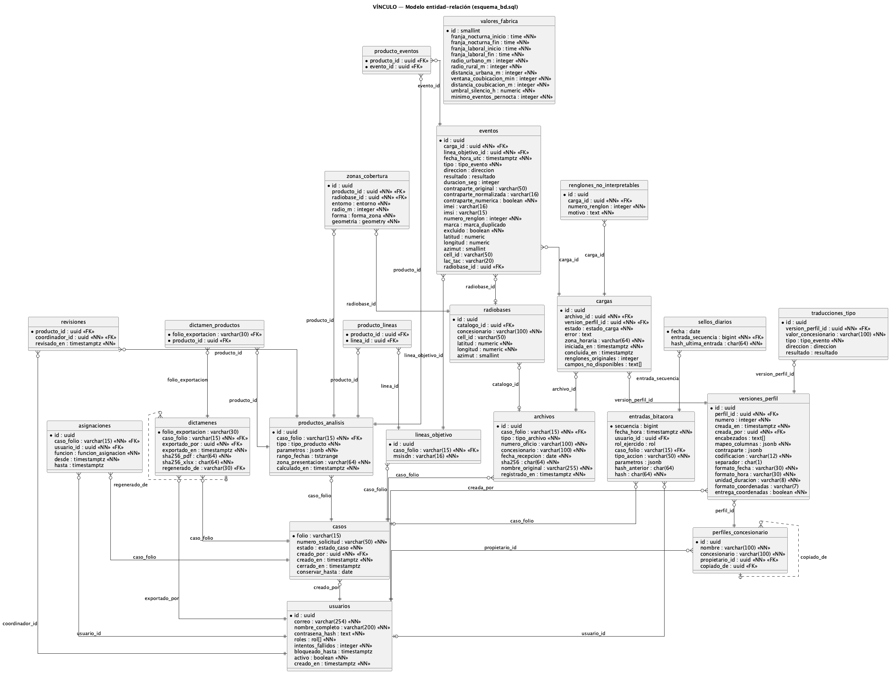

# Revisión crítica del esquema SQL — S05-S06-A1

**Equipo 3** · Repositorio del equipo: `CLA-TC4016-SN2026/TC4016-03` · Fecha: 24 de octubre de 2026

| Archivo | Qué es |
|---|---|
| `esquema_bd_v1_agente.sql` | Lo que generó el agente, **sin cambios** (evidencia) |
| `esquema_bd.sql` | Versión revisada: la que se importa y la que usa el backend |
| `esquema_bd_er.puml` → `imagenes/esquema_bd_er.png` | Diagrama entidad-relación generado del catálogo de PostgreSQL tras importar |
| `vinculo/docker/postgres/init/02_esquema_bd.sql` | Copia de `esquema_bd.sql` para inicializar un volumen vacío |

---

## 1. Qué generó el agente

**Instrucción.** Al agente de Cursor (Claude) se le pidió el esquema físico para PostgreSQL 18 +
PostGIS a partir de los dos artefactos consolidados en la Parte 0: `diagrama_clases_equipo.puml`
y `openapi_equipo.yaml`.

**Resultado (v1).** 271 líneas, 22 tablas, 12 enumeraciones, 6 índices adicionales, **ninguna
restricción `CHECK` y ningún trigger**. Se importó sin errores en una base de prueba
(`prueba_v1`). Traducía bien la estructura: entidades, llaves primarias, llaves foráneas,
multiplicidades y enumeraciones del contrato. Fallaba en las **reglas**: casi todas las
invariantes del dominio, que el diagrama y el SRS expresan como notas o criterios de aceptación,
quedaron fuera del esquema.

Hay además una **regresión** frente al código existente. La tabla `usuarios` del backend de
S05-S06-A2 ya hacía único el correo sin distinguir mayúsculas y exigía al menos un rol. El
agente trabajó solo con el diagrama y el contrato, que no expresan esas reglas, y las perdió.
Es la lección principal de esta revisión: el agente genera lo que está escrito en sus insumos y
no infiere las invariantes que solo viven en el SRS o en el código.

## 2. Método

1. Importar la v1 tal cual en `prueba_v1`.
2. **Pruebas de ataque**: por cada regla del dominio, insertar o modificar datos que la violan.
   Si la v1 los acepta, es un defecto demostrado y no una opinión (§3, columna «Evidencia»).
3. Revisión cruzada de tipos y restricciones contra el contrato, el diagrama y `SRS_equipo.md`.
4. Corregir, importar la versión revisada en una base limpia (`prueba_v2`) y **repetir las
   mismas pruebas** (§6).

## 3. Hallazgos y correcciones

«Evidencia» es lo que la v1 aceptó en `prueba_v1`. Las filas marcadas con 🧑‍⚖️ son decisiones
de dominio que tomó el equipo (§4); el resto son defectos objetivos frente al contrato o al SRS.

| ID | Hallazgo en la v1 | Evidencia | Corrección en `esquema_bd.sql` | Fundamento |
|---|---|---|---|---|
| R-1 | `UNIQUE` sobre `correo` distingue mayúsculas | Aceptó `Coord@…` y `coord@…` como dos usuarios | Índice único sobre `lower(correo)` | O-3: el correo es el identificador de acceso; dos cuentas con el mismo correo rompen el login y la atribución en bitácora |
| R-2 | `roles` admite arreglo vacío | Aceptó un usuario con `{}` | `CHECK (cardinality(roles) > 0)` | D-1: un usuario tiene uno o más roles; sin rol, la matriz RNF-01 no aplica |
| R-3 | El folio no tiene valor por omisión | El folio quedaba a cargo de la aplicación | Secuencia y valor por omisión `VIN-AAAA-NNNNNN` (año en hora de la Ciudad de México) más `CHECK` del patrón | O-9: formato del contrato; generarlo en la base evita que dos altas simultáneas produzcan el mismo folio |
| R-4 | Ni el estado ni el folio se validan | Aceptó un caso `CERRADO` sin `cerrado_en` y un folio `X` | `CHECK ((estado='CERRADO') = (cerrado_en IS NOT NULL))`; `conservar_hasta` solo en casos cerrados | O-4: el cierre es un hecho fechado de la cadena de custodia |
| R-5 | Nada impide dos asignaciones vigentes de la misma función | Aceptó dos analistas vigentes en el mismo caso | Índices únicos parciales (`WHERE hasta IS NULL`): un analista y un MP solicitante vigentes por caso; un perito no se repite | C-2 y RNF-02: «el analista asignado» debe ser uno; el historial se conserva cerrando `hasta` |
| R-6 | `msisdn varchar(15)` | Rechazó un E.164 válido de 15 dígitos más el `+` (16 caracteres) y aceptó texto libre | `varchar(16)` y `CHECK ~ '^\+[1-9]\d{6,14}$'`; igual en `contraparte_normalizada` | RF-23: normalización E.164 (máximo 15 dígitos más `+`) |
| R-7 🧑‍⚖️ | La bitácora admite `UPDATE` y `DELETE` | Modificó y borró entradas | Trigger `bitacora_solo_agregar()` en `BEFORE UPDATE OR DELETE` (por renglón) y `BEFORE TRUNCATE` | RNF-05: la bitácora es de solo agregar; la cadena de hashes no basta si se puede reescribir |
| R-8 | Los hashes no se validan | Aceptó `sha256 = 'NO-ES-HEX'` | `CHECK ~ '^[a-f0-9]{64}$'` en los seis campos hash | Patrón del contrato; RF-03 (integridad de la evidencia) |
| R-9 🧑‍⚖️ | `ON DELETE CASCADE` desde `casos` | Al borrar un caso desaparecieron sus líneas, asignaciones y archivos | Sin cascada desde `casos` (RESTRICT por omisión) | O-4: un caso nunca se borra; un borrado accidental no debe arrastrar la evidencia |
| R-10 | `valores_fabrica` admite varias filas | Aceptó una segunda fila | `CHECK (id = 1)` | RF-28: un solo juego de valores vigente |
| R-11 | Índice redundante sobre `correo` | `usuarios_correo_key` e `idx_usuarios_correo` duplicaban trabajo en cada escritura | Un solo índice, el único de R-1 | Mantenimiento y espacio |
| R-12 | 22 llaves foráneas sin índice | Consulta a `pg_constraint` y `pg_index` | De 34 FK, 24 quedan cubiertas por un índice nuevo, la llave primaria o un `UNIQUE` compuesto (caso, carga, línea, producto, perfil, propietario); índice parcial de asignaciones vigentes por usuario. Quedan 10 sin índice a propósito: apuntan a padres que no se borran (`usuarios` se desactiva, `radiobases`, `versiones_perfil`) o que no se recorren en ese sentido | Un índice por FK encarece cada escritura en `eventos`, la tabla más grande; se indexa lo que se consulta. «Mis casos» (RNF-02) filtra por usuario |
| R-13 🧑‍⚖️ | `eventos.id` es `bigint` | El contrato declara `Evento.id` como `uuid` | `uuid`; `producto_eventos.evento_id` también | Coherencia con el contrato: el identificador se expone en la API (RF-16) |
| R-15 | `versiones_perfil` no registra autor | El contrato exige `VersionPerfil.creadaPor` | `creada_por uuid NOT NULL` con FK a `usuarios` | RF-29-AC-4: cada versión es inmutable y atribuible |
| R-16 | Codificación, unidad de duración y formato de coordenadas como texto libre | Aceptaban cualquier valor | `CHECK IN` con los valores de los enums del contrato | El intérprete de sábanas depende de esos valores |
| R-17 🧑‍⚖️ | Sin límite de líneas ni bloqueo por caso cerrado | Aceptó líneas sin límite y en casos cerrados | Trigger `lineas_objetivo_validar()`: bloquea la fila del caso (`FOR UPDATE`) y rechaza la línea 21 o un caso cerrado | RF-02 (máximo 20) y RF-27-AC-1 (caso cerrado de solo lectura) |
| R-18 | Franjas horarias en `jsonb` | Sin validación de formato | Columnas `time` (inicio y fin) y fila con los valores de fábrica de S-08 | El contrato define `Franja` como `HH:MM`; `time` lo valida el manejador |
| R-19 | `umbral_silencio_h integer` | El contrato lo declara `number` | `numeric(5,2)` | Coherencia con el contrato (admite 12.5 h) |

**Restricciones adicionales** sin defecto previo demostrado, que endurecen datos de entrada:
rangos de latitud y longitud; azimut entre 0 y 359; IMEI de 14 a 16 dígitos e IMSI de 6 a 15;
`ST_IsValid` sobre la geometría de las zonas (RD-04: polígonos válidos, nunca puntos); en una
carga, `error` solo si está `FALLIDA`; y en una asignación, `hasta >= desde`.

**Resultado:** de 0 a 50 restricciones `CHECK`, de 6 a 23 índices adicionales, y 3 triggers.

## 4. Decisiones de dominio del equipo

Cuatro correcciones admitían más de una solución técnicamente válida. Se presentaron las
opciones y el equipo decidió:

| ID | Opciones | Decisión | Por qué |
|---|---|---|---|
| R-9 | `CASCADE` · `RESTRICT` · borrado lógico | **RESTRICT** | El caso no se borra (O-4); si algún día existe una purga por plazo de conservación (S-13), será un proceso explícito y auditado, no un efecto lateral |
| R-7 | Trigger · `REVOKE UPDATE, DELETE` a un rol de aplicación | **Trigger** | El `REVOKE` exige que la aplicación se conecte con un rol distinto del dueño, que hoy no existe; el trigger protege ya, cualquiera que sea el rol |
| R-13 | `bigint` (más compacto para millones de eventos) · `uuid` (el contrato) | **uuid** | El contrato manda; cambiarlo afectaría RF-16 y a los consumidores de la API |
| R-17 | Solo en la API · solo en la base · ambos | **Ambos** | La API valida primero y responde 422 con un mensaje claro; el trigger es la última barrera ante una condición de carrera o un acceso directo a la base |

## 5. Cambios que el SQL obligó a hacer en el contrato y el diagrama

| ID | Artefacto | Cambio |
|---|---|---|
| R-14 | `openapi_equipo.yaml` | `EntradaBitacora.rolEjercido` tenía un enum propio sin `ADMINISTRADOR`. Ahora referencia `Rol` (`allOf` + `nullable`), así que las acciones de administración de cuentas pueden registrarse en bitácora |
| R-15 | `diagrama_clases_equipo.puml` | Nueva relación `VersionPerfil "0..*" --> "1" Usuario : creadaPor`, que el contrato ya exigía |
| R-19 | `diagrama_clases_equipo.puml` | `ValoresFabrica.umbralSilencioH : decimal`, igual que el contrato |

El contrato sigue validando (`openapi-spec-validator`: OK) y el diagrama se volvió a generar.

## 6. Verificación

**Importación en base limpia** (`prueba_v2`): sin errores. **Repetición de las pruebas de
ataque** sobre la versión revisada:

| ID | Prueba | v1 | Revisada |
|---|---|---|---|
| R-1 | Mismo correo con otras mayúsculas | Aceptó | Rechazó: `usuarios_correo_unico` |
| R-2 | Usuario sin roles | Aceptó | Rechazó: `usuarios_roles_check` |
| R-3 | Alta de caso sin folio | Error (sin valor por omisión) | Generó `VIN-2026-000001` |
| R-4 | Caso `CERRADO` sin fecha de cierre | Aceptó | Rechazó: `casos_check` |
| R-4 | Folio `X` | Aceptó | Rechazó: `casos_folio_check` |
| R-5 | Segundo analista vigente | Aceptó | Rechazó: `asignaciones_analista_vigente` |
| R-6 | E.164 de 15 dígitos (`+123456789012345`) | Rechazó | Aceptó |
| R-6 | Número sin formato (`5512345678`) | Aceptó | Rechazó: `lineas_objetivo_msisdn_check` |
| R-17 | Línea 21 del caso | Aceptó | Rechazó: «ya tiene 20 líneas objetivo» |
| R-17 | Línea en caso cerrado | Aceptó | Rechazó: «está cerrado» |
| R-7 | `UPDATE` y `DELETE` en bitácora | Aceptó | Rechazó: «La bitácora es de solo agregar (RNF-05)» |
| R-8 | SHA-256 no hexadecimal | Aceptó | Rechazó: `archivos_sha256_check` |
| R-9 | Borrar un caso con líneas | Borró en cascada | Rechazó: `lineas_objetivo_caso_folio_fkey` |
| R-10 | Segunda fila de valores de fábrica | Aceptó | Rechazó: `valores_fabrica_id_check` |
| R-11 | Índices sobre `correo` | Dos | Uno |
| R-12 | Llaves foráneas sin índice | 22 | 10, deliberadas |

**Importación en la base del proyecto** (`vinculo`, contenedor `vinculo-db-1`). Se respaldaron
los usuarios de A2 (incluido el hash bcrypt del administrador), se reemplazó el esquema mínimo
de A2, se aplicó `esquema_bd.sql` y se restauraron los usuarios. `\dt`:

```text
                     List of tables
 Schema |            Name             | Type  |  Owner
--------+-----------------------------+-------+---------
 public | archivos                    | table | vinculo
 public | asignaciones                | table | vinculo
 public | cargas                      | table | vinculo
 public | casos                       | table | vinculo
 public | dictamen_productos          | table | vinculo
 public | dictamenes                  | table | vinculo
 public | entradas_bitacora           | table | vinculo
 public | eventos                     | table | vinculo
 public | lineas_objetivo             | table | vinculo
 public | perfiles_concesionario      | table | vinculo
 public | producto_eventos            | table | vinculo
 public | producto_lineas             | table | vinculo
 public | productos_analisis          | table | vinculo
 public | radiobases                  | table | vinculo
 public | renglones_no_interpretables | table | vinculo
 public | revisiones                  | table | vinculo
 public | sellos_diarios              | table | vinculo
 public | spatial_ref_sys             | table | vinculo
 public | traducciones_tipo           | table | vinculo
 public | usuarios                    | table | vinculo
 public | valores_fabrica             | table | vinculo
 public | versiones_perfil            | table | vinculo
 public | zonas_cobertura             | table | vinculo
(23 rows)
```

Son 22 tablas del modelo más `spatial_ref_sys`, que es de PostGIS. Los 3 usuarios sintéticos se
restauraron con sus hashes intactos.

**Diagrama entidad-relación**, generado del catálogo (no del archivo), con 22 tablas y 34 llaves
foráneas:



### Correspondencia entre clases y tablas

El diagrama de clases tiene 38 elementos y el esquema 22 tablas. No falta ninguna entidad: cada
elemento se persiste con una de cuatro técnicas.

| Técnica | Clases del diagrama | Dónde quedan en `esquema_bd.sql` |
|---|---|---|
| **Tabla propia** (19) | `Usuario`, `Caso`, `LineaObjetivo`, `Asignacion`, `ArchivoRecibido`, `PerfilConcesionario`, `VersionPerfil`, `TraduccionTipo`, `Carga`, `RenglonNoInterpretable`, `Evento`, `Radiobase`, `ProductoAnalisis`, `ZonaCobertura`, `Revision`, `Dictamen`, `EntradaBitacora`, `SelloDiario`, `ValoresFabrica` | `usuarios`, `casos`, `lineas_objetivo`, `asignaciones`, `archivos`, `perfiles_concesionario`, `versiones_perfil`, `traducciones_tipo`, `cargas`, `renglones_no_interpretables`, `eventos`, `radiobases`, `productos_analisis`, `zonas_cobertura`, `revisiones`, `dictamenes`, `entradas_bitacora`, `sellos_diarios`, `valores_fabrica` |
| **Herencia en una sola tabla** (10) | `Sabana`, `CatalogoRadiobases` | `archivos`, distinguidas por `tipo` (`SABANA`, `CATALOGO`) |
| | `RankingContactos`, `PatronPernocta`, `Desplazamiento`, `CambioIdentificadores`, `RupturaPatron`, `ActividadDiurna`, `CoUbicacion`, `Intermediarios` | `productos_analisis`, distinguidas por `tipo` (`CONTACTOS`, `PERNOCTA`, `DESPLAZAMIENTO`, `IDENTIFICADORES`, `RUPTURAS`, `ACTIVIDAD_DIURNA`, `COUBICACION`, `INTERMEDIARIOS`) |
| **Objeto de valor incrustado** (1) | `UbicacionReportada` | Columnas `latitud`, `longitud`, `azimut`, `cell_id` y `lac_tac` de `eventos` |
| **Tipo enumerado** (8) | `Rol`, `EstadoCaso`, `FuncionAsignacion`, `EstadoCarga`, `TipoEvento`, `Direccion`, `Resultado`, `MarcaDuplicado` | `CREATE TYPE … AS ENUM` con los mismos valores que `openapi_equipo.yaml`; `Rol` se usa como arreglo `rol[]` en `usuarios.roles` |

Las otras 3 tablas resuelven asociaciones muchos a muchos del diagrama y no son clases:
`producto_lineas` (`ProductoAnalisis` → `LineaObjetivo` : analiza), `producto_eventos`
(`ProductoAnalisis` → `Evento` : eventosDeOrigen) y `dictamen_productos` (`Dictamen` o--
`ProductoAnalisis`).

**Por qué una sola tabla por jerarquía.** Ninguna subclase declara atributos propios en el
diagrama: todo lo que tienen está en `ArchivoRecibido` o en `ProductoAnalisis`. Una tabla por
subclase solo agregaría tablas vacías unidas por llave primaria, sin integridad que ganar. Lo
que varía entre productos son sus parámetros, que van en `parametros` (`jsonb`). El objeto de
valor no tiene identidad ni ciclo de vida propios: existe solo dentro de su `Evento`, con
cardinalidad 1 a 1, así que una tabla aparte no aportaría nada.

## 7. Límites conocidos

- **El trigger de bitácora no detiene a un superusuario**, que puede desactivarlo. La protección
  completa exige que el backend se conecte con un rol sin privilegios de dueño. Es una decisión
  de acceso que corresponde al alumno y queda pendiente.
- **S-08 limita la franja laboral a lunes-viernes**, pero el contrato (`Franja`) solo modela
  horas. Se documenta como vacío del contrato y no se inventan columnas.
- **La visibilidad por asignación (RNF-02) no se impone en la base** (por ejemplo, con
  *row-level security*). Se aplica en la capa de servicios; la base solo garantiza la unicidad
  de las asignaciones vigentes.
- `conservar_hasta` (S-13) existe, pero el plazo de conservación sigue sin definirse en el SRS.

---

## Correcciones al código generado

### Qué generó el agente

Los servicios CRUD del núcleo acordado: **17 operaciones** del contrato sobre usuarios, casos,
líneas objetivo, asignaciones y perfiles de concesionario, en tres capas (A-1 de
`arquitectura_equipo.md`):

| Capa | Archivos (`vinculo/backend/src/`) | Responsabilidad |
|---|---|---|
| Rutas | `api/casos.py`, `api/perfiles.py`, `api/usuarios.py` | Forma de la petición (Pydantic), rol de `x-roles`, código HTTP y `Location` |
| Servicios | `services/casos.py`, `services/perfiles.py` | Reglas de negocio: visibilidad (RNF-02), cierre (O-4), 20 líneas (RF-02), normalización (RF-23), versiones y propiedad de perfiles (RF-29) |
| Repositorios | `db/casos.py`, `db/perfiles.py`, `db/usuarios.py` | SQL parametrizado, sin reglas |
| Transversal | `core/errores.py`, `core/telefonos.py` | Errores RFC 9457 (`application/problem+json`) y E.164 |

`PUT` y `DELETE /casos/{folio}` de la A2 se eliminaron (O-4): ahora responden `405`. Quedan
fuera del alcance acordado `DELETE /casos/{folio}/datos` y `GET /casos/{folio}/resumen`.

**Códigos HTTP** según el criterio O-6 del contrato: `400` si la forma es inválida, `422` si se
viola una regla del dominio (incluidos los obligatorios ausentes, con el mensaje de
RF-02-AC-2), `409` si se choca con el estado del recurso (caso cerrado), y `404` idéntico para un
caso ajeno y uno inexistente (RF-02-AC-9). Los límites de dominio (1 a 20 líneas, solicitud no
vacía) se validan en el servicio y no en Pydantic, para que respondan `422` y no `400`.

### Método de revisión

1. **Prueba de humo**: 78 verificaciones con `TestClient` contra una base desechable con el
   esquema revisado y usuarios sintéticos. Cubren cada operación, cada rol y cada criterio de
   aceptación que el núcleo implementa (RF-02-AC-2 y AC-4 a AC-9, RF-23-AC-1 y AC-2, RF-27-AC-1,
   RF-29-AC-2 y AC-4 a AC-6).
2. **Contrato contra código**: un script compara el OpenAPI que genera FastAPI con
   `openapi_equipo.yaml`. Revisa operaciones, nombres de parámetros, los roles que exige cada
   ruta frente a su `x-roles`, y las respuestas que el código puede emitir frente a las que el
   contrato declara.
3. **Lectura del framework**: semántica de las dependencias con `yield` en FastAPI 0.141.1.

### Hallazgos y correcciones

| ID | Hallazgo | Evidencia | Corrección |
|---|---|---|---|
| K-1 | **El commit ocurría después de enviar la respuesta.** En FastAPI 0.141 una dependencia con `yield` sin `scope` se cierra después de responder, y `get_db` (heredado de la A2) hace el commit al cerrarse | Con un commit que falla, el cliente recibió `201` y el folio `VIN-2026-000003`, pero la base seguía con 2 casos: un folio entregado de un caso inexistente | `Depends(get_db, scope="function")` en un único alias `Db` (`db/connection.py`) que usan todas las rutas. La misma prueba ahora responde `500 Error interno` y la base queda coherente |
| K-2 | Los parámetros de ruta se llamaban `perfil_id` y `usuario_id`; el contrato dice `perfilId` y `usuarioId` | Script contrato-código: 5 operaciones | `Path(alias="perfilId")` y `Path(alias="usuarioId")` |
| K-3 | Un identificador de ruta mal formado (`/perfiles/abc`, versión `0`) respondía `400`, que esas operaciones no declaran | Prueba de humo | Un identificador inválido nombra un recurso que no existe: `404 Recurso no encontrado` |
| K-4 | Los `404` y `405` del framework salían con el título en inglés («Not Found») | Prueba de humo | Títulos en español en el manejador global |
| K-5 | El contrato no declaraba respuestas que el código emite correctamente: `403` en 5 `GET` restringidos por `x-roles` (caso, líneas, perfil, versiones, versión) y `422` en `register` y en `PATCH /casos/{folio}` por obligatorios ausentes | Script contrato-código: 7 hallazgos | Se agregaron al contrato (`openapi_equipo.yaml`, 14 líneas); sigue validando |

Tras las correcciones: **78 de 78** verificaciones correctas y **0 hallazgos** del script
contrato-código.

### Controles que el código ya traía y se verificaron

- La validación nunca devuelve el valor rechazado: con una contraseña inválida, la respuesta no
  la contiene (control H-1 de la A2, ahora en el manejador global).
- La autenticación y el rol se resuelven antes de validar el cuerpo: un rol sin permiso recibe
  `403` sin enterarse de qué campos espera la operación.
- Cada escritura sobre un caso bloquea su fila (`FOR UPDATE`): dos asignaciones simultáneas no
  dejan dos analistas vigentes, y el trigger de 20 líneas (R-17) queda como última barrera.
- Reasignar cierra la asignación vigente (`hasta`) en lugar de borrarla: el historial de quién
  tuvo acceso a qué caso se conserva.

### Límites conocidos

- **Bitácora:** RF-02-AC-3 («la bitácora registra la línea agregada») y RF-02-AC-9 / RF-21-AC-2
  («acceso rechazado») requieren la bitácora encadenada, que llega con RF-21. Las rutas ya
  distinguen el punto exacto donde se registrará cada evento.
- **Folio:** la secuencia no se reinicia cada año (`VIN-2027-000124` sigue a
  `VIN-2026-000123`), y un alta que falla después de tomar el número deja un hueco. Para la
  cadena de custodia el folio es un identificador, no un conteo, pero conviene validarlo con la
  unidad.
- **Perfiles:** el nombre y el concesionario viven en el perfil, no en la versión; una versión
  antigua muestra el nombre vigente. El listado hace dos consultas por perfil, aceptable para
  decenas de perfiles.
- Reasignar el analista de un caso cerrado se permite: el contrato no declara `409` para esa
  operación y el cierre protege los datos del caso, no su consulta.
